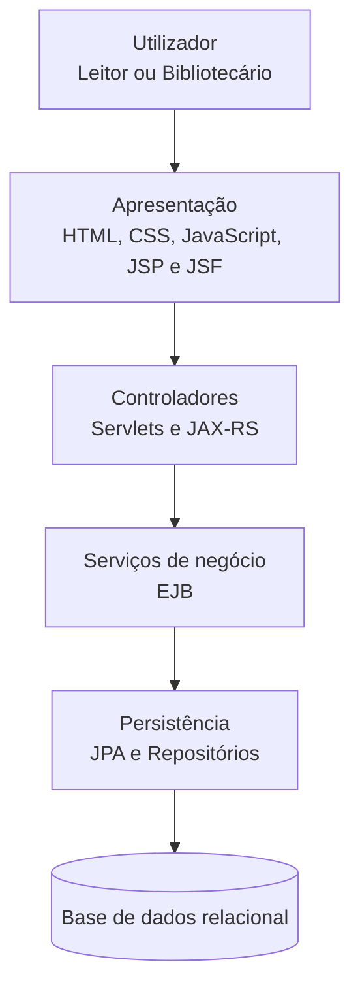

# Arquitetura do BiblioEscola

## Visão geral

O BiblioEscola utiliza uma arquitetura em camadas, com separação entre apresentação, aplicação, regras de negócio e persistência.

## Diagrama de arquitetura



## Responsabilidades das camadas

### 1. Apresentação

Responsável pela interface utilizada pelos leitores e bibliotecários.

Tecnologias previstas:
- HTML
- CSS
- JavaScript
- JSP
- JSF

### 2. Controladores

Recebem os pedidos dos utilizadores e comunicam com os serviços de negócio.

Tecnologias previstas:
- Jakarta Servlets
- JAX-RS

### 3. Serviços de negócio

Aplicam as regras de empréstimos, reservas, devoluções e disponibilidade.

Tecnologia prevista:
- Enterprise JavaBeans (EJB)

### 4. Persistência

Responsável pelo acesso e armazenamento dos dados.

Tecnologias previstas:
- Jakarta Persistence (JPA)
- JPQL
- Repositórios

### 5. Base de dados

Armazena as informações das entidades:
- Livro
- Autor
- Categoria
- Leitor
- Emprestimo
- Reserva

## Comunicação e integrações futuras

- WebSocket: atualização de disponibilidade em tempo real
- JMS: processamento assíncrono de notificações
- SOAP: consulta externa da disponibilidade de livros
- Segurança Jakarta EE: autenticação e controlo de acesso

## Implementação atual

Na Etapa 1, apenas o endpoint inicial foi implementado.

Endpoint:

GET /biblioescola/api/estado

Classe:

src/main/java/pt/biblioescola/HelloServlet.java

As restantes camadas serão implementadas progressivamente.
```
